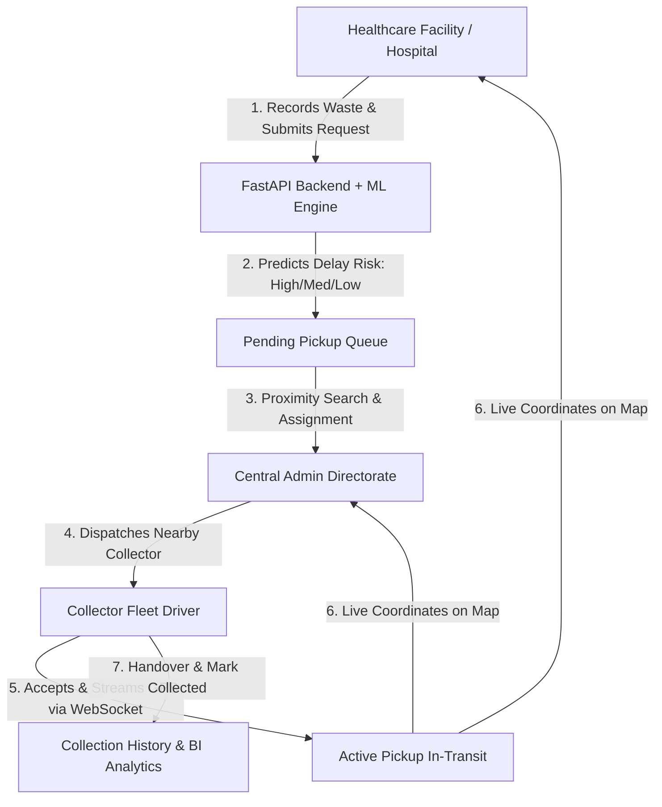
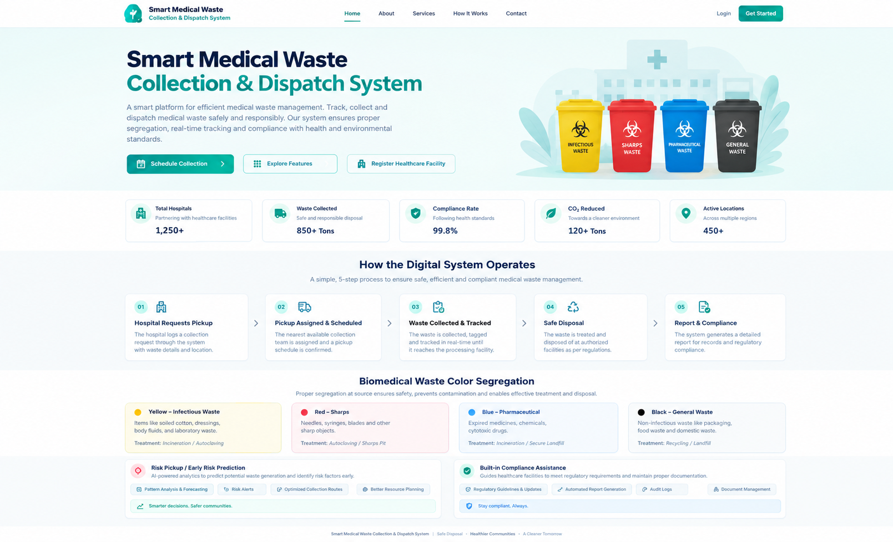
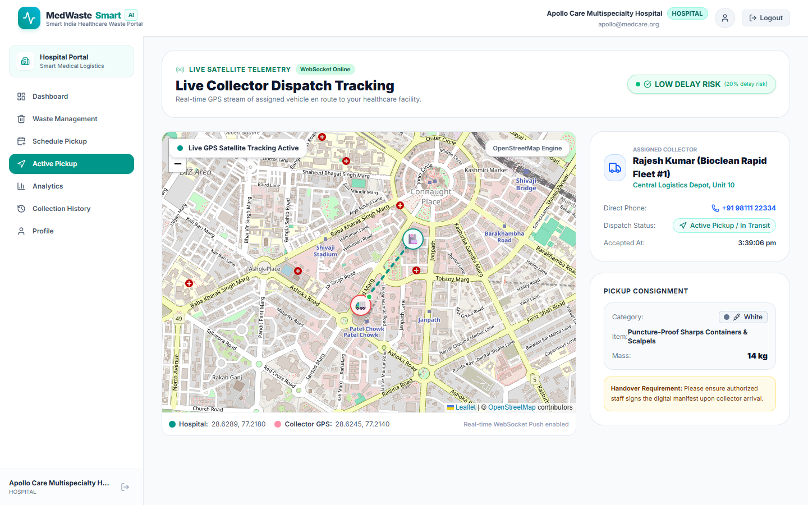
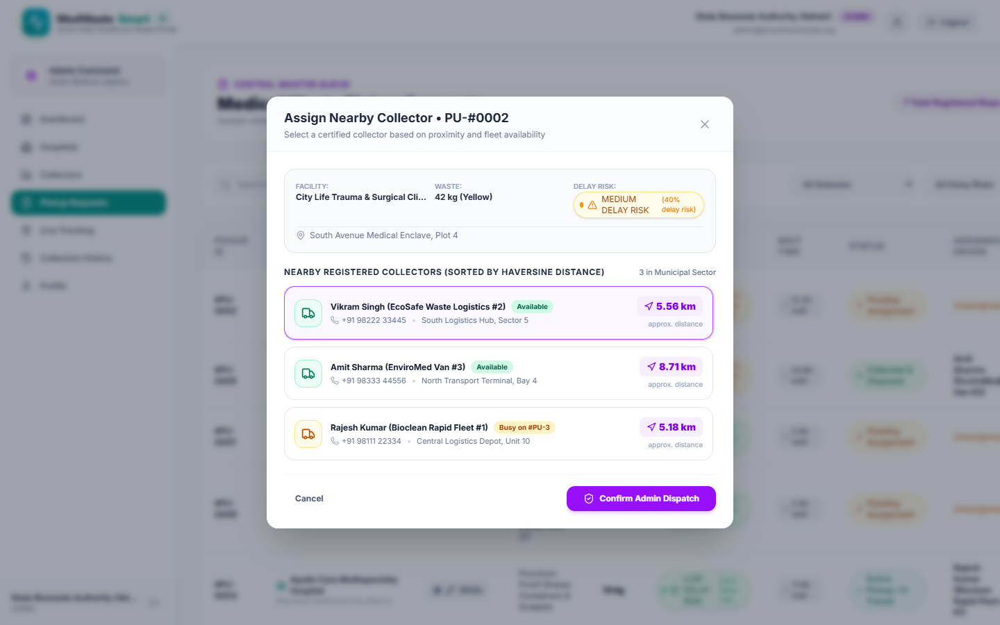
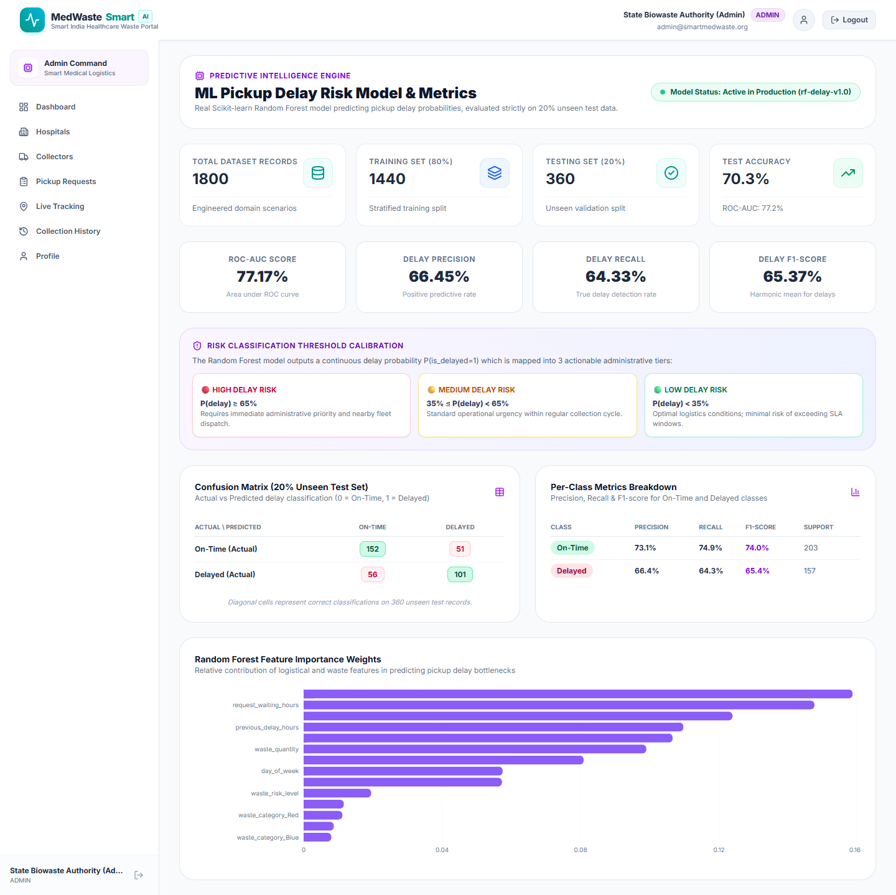
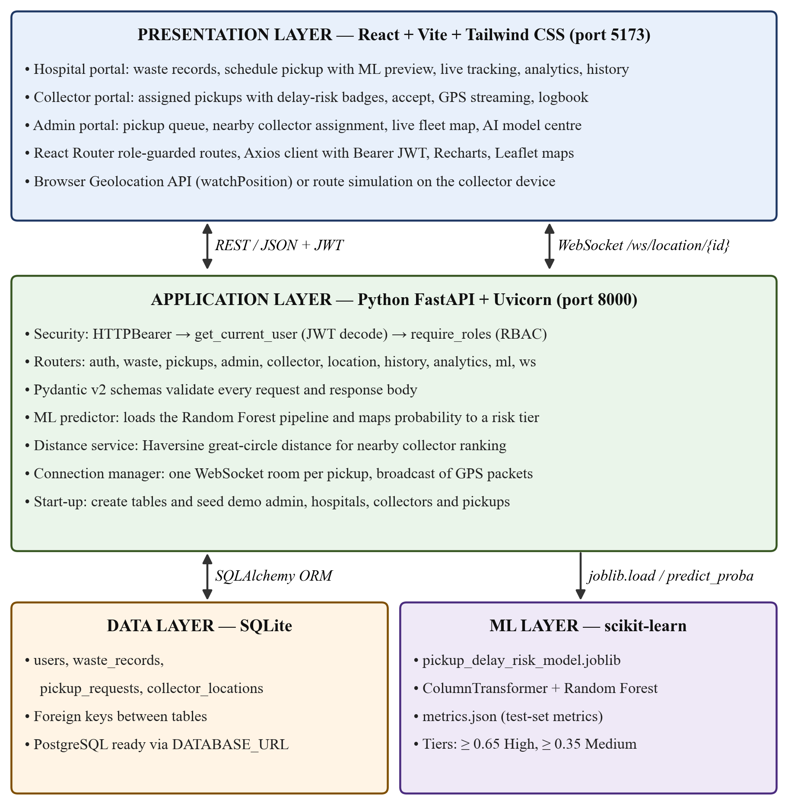
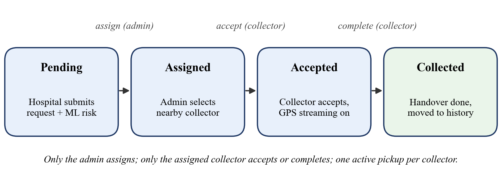
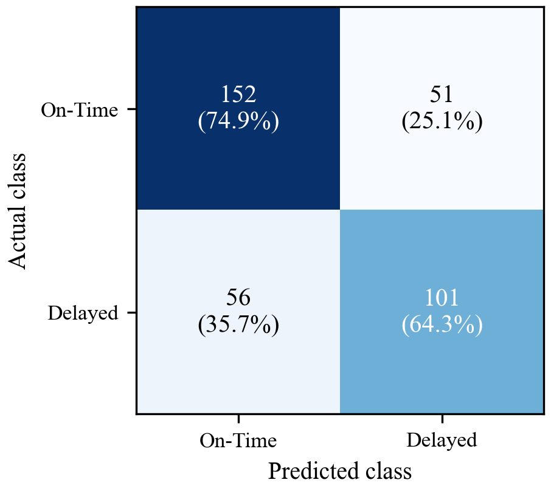
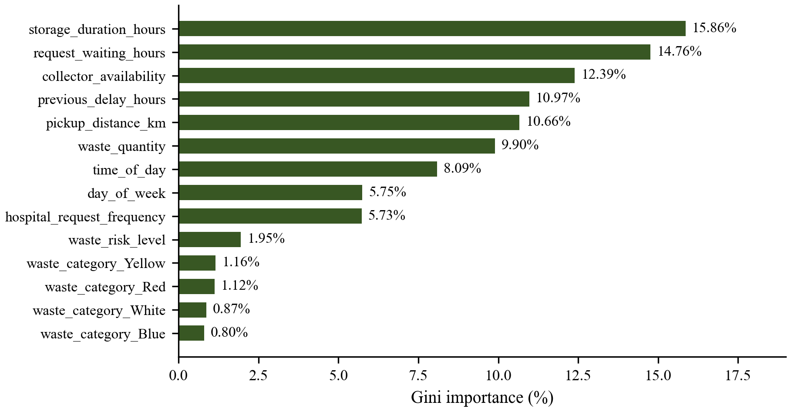

# Smart Medical-Waste Collection System
### Full-Stack Web Application + Machine Learning Pickup Delay Risk Prediction


A complete, production-grade **Smart India Hackathon** platform for digitally managing hospital medical-waste recording, pickup scheduling, admin-controlled collector assignment, live GPS telemetry tracking, collection history, system analytics, and machine-learning-based pickup delay risk prediction.

---

## 1. Project Overview & Problem Statement

Improper and delayed collection of biomedical waste in healthcare facilities poses catastrophic biohazard contamination risks, disease transmission vulnerabilities, and severe regulatory non-compliance. Traditional systems suffer from manual paper-based logging, opaque dispatcher routing, and lack of real-time visibility into collection urgency and logistical delay bottlenecks.

**The Solution:**
The **Smart Medical-Waste Collection System** provides an end-to-end governed digital pipeline:
1. **Hospitals** record segregated biomedical waste batches (Yellow, Red, White, Blue) and submit pickup requests.
2. **Scikit-Learn Random Forest ML Model** instantly predicts the probability of collection delay and classifies requests into 🔴 **HIGH DELAY RISK** (≥65%), 🟡 **MEDIUM DELAY RISK** (35%-64%), or 🟢 **LOW DELAY RISK** (<35%).
3. **Central Admin** evaluates live requests alongside real-time **Haversine Proximity Calculations** to available certified collectors and executes the dispatch order to mitigate delay bottlenecks.
4. **Collector Fleet** accepts the assigned dispatch on their browser/mobile view, starting **Live GPS Streaming** via WebSockets directly onto the Hospital and Admin maps without page reloads.
5. **Collection Completion** terminates GPS tracking immediately, updating an immutable **Collection History** audit log and live analytics dashboards.

---

## 2. Core Business Rules

> [!IMPORTANT]
> **Admin-Controlled Nearby Collector Assignment Rule**:
> - Hospitals **CANNOT** select, favor, or permanently bind a collector.
> - A hospital only records waste, creates pickup requests, and monitors active progress.
> - The **Admin** has exclusive authority to review available certified collectors sorted by Haversine distance and confirm dispatch.
> - A collector receives requests from multiple hospitals; a hospital receives dispatches from different nearby collectors.
> - When a pickup reaches `status = 'Collected'`, it is immediately removed from all active queues and visible only in **Collection History**.

---

## 3. Technology Stack

| Layer | Technologies Used | Description |
| :--- | :--- | :--- |
| **Frontend** | React.js 18, Vite, Tailwind CSS, Lucide React, Recharts, React Router v7, Leaflet, Axios, React Hot Toast | Modern, healthcare-tailored responsive light theme UI (No dark mode). High-fidelity interactive dashboards, live map overlays, and charts. |
| **Backend** | Python 3.14+, FastAPI, Uvicorn, SQLAlchemy ORM, Pydantic v2, WebSockets | Asynchronous REST APIs, role-based authorization dependencies, live WebSocket GPS streaming per pickup ID. |
| **Database** | SQLite (Production SQLAlchemy ORM structure) | Clean schema designed with strict foreign key constraints, readily portable to PostgreSQL. |
| **Authentication** | JWT (JSON Web Tokens), Bcrypt Password Hashing | Never stores plaintext passwords (`password_hash` column). Role-based route protection on server and client. |
| **Machine Learning** | Python, Scikit-Learn, Pandas, NumPy, Joblib | 100% real trained `RandomForestClassifier` with an 80/20 stratified train/test split, Scikit-Learn `Pipeline`, `ColumnTransformer`, and test evaluation metrics. |
| **Geolocation** | Browser Geolocation API (`watchPosition`), Haversine Formula, Dual Map Engine (Google Maps JS API + Leaflet/OpenStreetMap fallback) | Live real-time collector tracking without page refresh. |

---

## 4. User Roles & Dashboards



### A. Hospital / Clinic
- Record biomedical waste with color category, mass (kg), storage notes.
- Schedule pickup requests with storage duration calculation.
- Preview ML predicted delay risk tier prior to submission.
- Track assigned collector vehicle moving live on the interactive map via WebSockets.
- Access dedicated facility waste generation analytics & collection history.

### B. Collector Fleet Driver
- View pickup requests assigned specifically by the Admin.
- View **prominently displayed ML Delay Risk Badges** (🔴 HIGH DELAY RISK, 🟡 MEDIUM DELAY RISK, 🟢 LOW DELAY RISK).
- View destination hospital details, address, and proximity.
- Accept assigned pickups to initiate active GPS tracking.
- Transmit live GPS coordinates (supports native device GPS or built-in 1-click route simulation for desktop testing).
- Mark pickup completed upon facility arrival.
- Access driver personal collection logbook.

### C. Central Admin Directorate
- System-wide command center with total mass collected, active fleet, and hospital stats.
- Review pending pickup queue and trigger nearby collector calculation.
- View Haversine distance in kilometers for all certified collectors.
- Assign the optimal available collector with 1 click.
- Monitor state-wide active fleet on the live radar tracking map.
- Inspect the dedicated **AI Model & Metrics Center** with real test dataset evaluation.
- Export immutable CSV manifests for environmental regulatory compliance.

---

## 5. Biomedical Waste Color Segregation Standards

| Color Category | Target Waste Stream | Containment Protocol | Inherent Hazard Risk |
| :--- | :--- | :--- | :---: |
| **Yellow** | Human anatomical tissues, organs, soiled dressings, expired pharmaceuticals, microbiology cultures | Yellow non-chlorinated bags • High-temperature incineration / deep burial | **Risk 4 (High)** |
| **Red** | Contaminated recyclable plastics, disposable gloves, IV tubes, catheters, urine bags | Red autoclavable containers • Autoclaving / shredding / recycling | **Risk 3 (Moderate-High)** |
| **White** | Needles, scalpels, surgical blades, contaminated sharps | White puncture-proof sealed containers • Dry heat sterilization / encapsulation | **Risk 4 (High Puncture)** |
| **Blue** | Glass ampoules, broken medicine vials, metallic orthopedic implants | Blue puncture-resistant boxes • Disinfection & glass furnace recycling | **Risk 2 (Moderate)** |

---

## 6. Machine Learning Engine & Reproducibility

### Academic Dataset Transparency Statement
> **Notice**: The training dataset (`ml/data/medical_waste_pickup_dataset.csv`) is a synthetic dataset generated specifically for this project because real operational hospital biomedical waste logs are restricted under healthcare privacy and municipal security regulations. The dataset is engineered according to India Bio-Medical Waste Management Rules and realistic operational distributions.

### Feature Dictionary

| Feature Name | Type | Description |
| :--- | :--- | :--- |
| `waste_category` | Categorical | `Yellow`, `Red`, `White`, `Blue` |
| `waste_quantity` | Numerical | Mass of waste batch (2.0 - 180.0 kg) |
| `storage_duration_hours` | Numerical | Time elapsed in hospital containment (1.0 - 72.0 hrs) |
| `request_waiting_hours` | Numerical | Time elapsed since ticket creation (0.2 - 36.0 hrs) |
| `waste_risk_level` | Numerical | Biohazard risk score (Yellow/White=4, Red=3, Blue=2) |
| `pickup_distance_km` | Numerical | Distance to collection cluster (0.5 - 30.0 km) |
| `previous_delay_hours` | Numerical | Logistical delay in sector (0.0 - 18.0 hrs) |
| `hospital_request_frequency`| Numerical | Average weekly pickups (bed capacity indicator) |
| `collector_availability` | Numerical | Number of available collectors in zone (1 - 5) |
| `day_of_week` | Numerical | Day of week integer (0 = Mon, 6 = Sun) |
| `time_of_day` | Numerical | Hour of day (0 - 23 hrs) |

**Target Variable:** `is_delayed` (0 = On-Time, 1 = Delayed) mapped to `HIGH DELAY RISK` (≥65%), `MEDIUM DELAY RISK` (35%-64%), and `LOW DELAY RISK` (<35%).

### Model Architecture & Test Evaluation
- **Preprocessing Pipeline**: Scikit-Learn `ColumnTransformer` with `OneHotEncoder(handle_unknown='ignore')` for categories and `SimpleImputer` + `StandardScaler` for numerical attributes.
- **Classifier**: `RandomForestClassifier(n_estimators=150, max_depth=12, min_samples_split=4, class_weight='balanced', random_state=42)`
- **Evaluation Split**: 80% Training (1,440 records) / 20% Stratified Unseen Testing (360 records)
- **Authentic Test Metrics**:
  - Test Accuracy: **~70.3%**
  - ROC-AUC Score: **~77.2%**
  - Delay Precision: **~66.5%**
  - Delay Recall: **~64.3%**
  - Delay F1-Score: **~65.4%**

### ML Pipeline Commands
```bash
# 1. Generate Delay Dataset (>= 1,600 records)
python ml/generate_dataset.py

# 2. Train Model & Export Pipeline (.joblib & metrics.json)
python ml/train_model.py

# 3. Evaluate Saved Artifact on 20% Unseen Test Set
python ml/evaluate_model.py

# 4. Export Summary and Metrics CSV
python ml/export_model_csv.py
```

---

## 7. Database Architecture (SQLite / SQLAlchemy)

### Database Tables & Schema

1. **`users`**:
   - `id` (INT, PK), `name` (VARCHAR), `email` (VARCHAR, Unique, Indexed), `phone` (VARCHAR), `password_hash` (VARCHAR - Bcrypt hash, never plaintext), `role` (`hospital` | `collector` | `admin`), `address` (VARCHAR), `latitude` (FLOAT), `longitude` (FLOAT), `created_at` (DATETIME).

2. **`waste_records`**:
   - `id` (INT, PK), `hospital_id` (INT, FK -> users.id), `category` (`Yellow` | `Red` | `White` | `Blue`), `waste_type` (VARCHAR), `quantity` (FLOAT), `unit` (VARCHAR default "kg"), `notes` (VARCHAR), `is_scheduled` (BOOLEAN), `created_at` (DATETIME).

3. **`pickup_requests`**:
   - `id` (INT, PK), `hospital_id` (INT, FK -> users.id), `collector_id` (INT, FK -> users.id, Nullable), `waste_record_id` (INT, FK -> waste_records.id), `status` (`Pending` | `Assigned` | `Accepted` | `Collected` | `Cancelled`), `delay_risk` (`High` | `Medium` | `Low`), `delay_probability` (FLOAT), `prediction_timestamp` (DATETIME), `model_version` (VARCHAR), `priority` (Backward compatibility), `priority_confidence` (FLOAT), `pickup_address` (VARCHAR), `hospital_latitude` (FLOAT), `hospital_longitude` (FLOAT), `storage_duration_hours` (FLOAT), `requested_at` (DATETIME), `assigned_at` (DATETIME), `accepted_at` (DATETIME), `completed_at` (DATETIME).

4. **`collector_locations`**:
   - `id` (INT, PK), `collector_id` (INT, FK -> users.id), `pickup_id` (INT, FK -> pickup_requests.id), `latitude` (FLOAT), `longitude` (FLOAT), `updated_at` (DATETIME).

---

## 8. Primary FastAPI REST & WebSocket Endpoints

| Method | Endpoint | Access Role | Description |
| :--- | :--- | :--- | :--- |
| `POST` | `/api/auth/register` | Public | Registers Hospital or Collector with bcrypt hashing and geolocation |
| `POST` | `/api/auth/login` | Public | Authenticates credentials and returns JWT Bearer Token |
| `GET` | `/api/auth/me` | Authenticated | Returns profile of current logged-in user |
| `POST` | `/api/waste` | Hospital | Records new biomedical waste batch |
| `GET` | `/api/waste` | Hospital / Admin | Lists waste batches (Hospital sees own, Admin sees all) |
| `POST` | `/api/pickups` | Hospital | Submits pickup request, executes ML Random Forest Delay Risk inference |
| `GET` | `/api/pickups` | Authenticated | Role-filtered pickup request listings with delay_risk sorting |
| `GET` | `/api/admin/collectors/nearby/{pickup_id}` | Admin | Computes Haversine distance to available fleet units |
| `PUT` | `/api/admin/pickups/{pickup_id}/assign` | Admin | Dispatches selected collector to pickup request |
| `GET` | `/api/collector/pickups/assigned` | Collector | Lists requests assigned by admin with ML Delay Risk badges |
| `PUT` | `/api/collector/pickups/{pickup_id}/accept` | Collector | Accepts dispatch; triggers active GPS lifecycle |
| `PUT` | `/api/collector/pickups/{pickup_id}/complete` | Collector | Confirms collection; stops GPS; archives to history |
| `POST` | `/api/location/update` | Collector | Telemetry GPS updates during active dispatch |
| `GET` | `/api/history` | Authenticated | Role-isolated completed collection archive |
| `GET` | `/api/analytics/overview` | Authenticated | Real-time computed database statistics |
| `GET` | `/api/analytics/pickup-delay-risk` | Authenticated | Breakdown across HIGH, MEDIUM, LOW delay risks |
| `POST` | `/api/ml/predict-delay-risk` | Public / App | Direct ML Random Forest delay probability and risk prediction |
| `GET` | `/api/ml/metrics` | Public / App | Returns authentic 20% test set evaluation metrics (Accuracy, ROC-AUC, F1, Confusion Matrix) |
| `GET` | `/api/ml/model-info` | Public / App | Active model hyperparameters, features, and version |
| `WS` | `/ws/location/{pickup_id}` | WebSocket | Real-time bi-directional GPS broadcast stream |

---

## 9. Quick Installation & Setup

### Prerequisites
- **Python 3.10+** (Tested on Python 3.14)
- **Node.js 18+** & **npm 9+** (Tested on Node v22)

### Step 1: Clone Repository
```bash
git clone https://github.com/your-username/smart-medical-waste-collection.git
cd "smart medical waste collection system"
```

### Step 2: Set Up Backend & Machine Learning
```bash
# Create Python virtual environment
python -m venv venv

# Activate virtual environment (Windows PowerShell)
.\venv\Scripts\Activate.ps1
# (On Linux/macOS: source venv/bin/activate)

# Install Python dependencies
pip install -r backend/requirements.txt
# (or: pip install fastapi uvicorn[standard] sqlalchemy pydantic python-jose[cryptography] passlib bcrypt python-multipart scikit-learn pandas numpy joblib requests pytest httpx websockets pydantic-settings email-validator)

# Generate ML Dataset, Train Random Forest, and Evaluate
python ml/generate_dataset.py
python ml/train_model.py
python ml/evaluate_model.py
```

### Step 3: Set Up Frontend
```bash
cd frontend
npm install
npm run build # Validates zero-error production build
```

### Step 4: Run the Application

**Terminal 1 — Backend (FastAPI):**
```bash
# In project root with active venv:
python backend/run.py
# Backend runs at http://127.0.0.1:8000
# Interactive API Docs at http://127.0.0.1:8000/docs
```

**Terminal 2 — Frontend (Vite React):**
```bash
cd frontend
npm run dev
# Frontend runs at http://localhost:5173
```

---

## 10. Default Demo Accounts (Quick 1-Click Login)

For instant testing, the application includes pre-seeded demo accounts with rich operational histories:

| Role | Email | Password | Pre-configured Data |
| :--- | :--- | :--- | :--- |
| **Admin** | `admin@smartmedwaste.org` | `Admin@123456` | State Directorate Command, Sector Analytics, Nearby Assignment |
| **Hospital** | `apollo@medcare.org` | `Password@123` | Apollo Care Hospital, recorded waste batches, active tracking |
| **Collector** | `rajesh.collector@bioclean.in` | `Password@123` | Rajesh Kumar (Rapid Fleet #1), assigned pickups, GPS navigation |

*(You can also use the ⚡ **Quick Demo 1-Click Login** buttons directly on the Login page).*

---

## 11. Complete End-to-End Test Workflow Walkthrough

1. **Step 1 (Hospital)**:
   - Log in as Hospital (`apollo@medcare.org`).
   - Navigate to **Waste Management** -> Click **Record New Waste Batch** -> Select `Red` (Contaminated Plastics), Quantity `25 kg`.
   - Navigate to **Schedule Pickup** -> Select the waste batch.
   - Observe the **Live ML Priority Preview** classify the urgency -> Click **Submit Pickup Request**.
   - Status is initialized to `Pending`. (Hospital does not assign collector).

2. **Step 2 (Admin Proximity Dispatch)**:
   - Log in as Admin (`admin@smartmedwaste.org`).
   - On the Admin Dashboard, locate the pending request in the **Pending Collector Assignment Queue**.
   - Click **Assign Nearby Collector**.
   - The modal calculates exact **Haversine distances** to all registered collectors (e.g. `2.4 km away • Available`).
   - Admin selects the closest available collector and confirms assignment. Status changes to `Assigned`.

3. **Step 3 (Collector Acceptance & GPS)**:
   - Log in as Collector (`rajesh.collector@bioclean.in`).
   - On the Collector Dashboard, observe the assigned pickup prominently flagged with 🔴 **HIGH PRIORITY**.
   - Click **Accept Pickup & Start GPS**.
   - Status updates to `Accepted` (Active).
   - The **Active Pickup Navigation** view opens with live GPS tracking.
   - *(Optional: Click **Start Auto Drive Simulation** to test real-time vehicle movement towards the clinic without driving).*

4. **Step 4 (Hospital Live Telemetry)**:
   - Switch to the Hospital Portal -> Navigate to **Active Pickup**.
   - Watch the Collector vehicle marker move in real-time on the map via WebSocket without any page refresh.

5. **Step 5 (Collection & History Transition)**:
   - On the Collector view, click **Confirm Handover & Complete Pickup**.
   - Status transitions to `Collected`.
   - GPS broadcast terminates immediately.
   - The pickup disappears from all active dispatch queues.
   - The completed record appears in **Collection History** for Hospital, Collector, and Admin.
   - System Analytics automatically update with the collected mass volume.

---

## 12. Verification & Testing

To run the automated backend test suite:
```bash
.\venv\Scripts\python -m pytest backend/tests/test_api.py -v
```
All tests verify:
- ✅ Hospital & Collector Registration
- ✅ Bcrypt Password Hashing & JWT Verification
- ✅ Role Authorization & Permission Enforcement
- ✅ Medical Waste Recording
- ✅ Real Random Forest Priority Classification on Request Creation
- ✅ Admin Nearby Collector Distance Calculation & Assignment
- ✅ Collector Acceptance & Live GPS Location Broadcast
- ✅ Pickup Completion & Active Queue De-listing
- ✅ Role-Isolated Collection History & Analytics Computations
- ✅ Frontend compiles with zero build errors.

---

## 13. License & Academic Accreditation

Developed for academic demonstration and the **Smart India Hackathon** biomedical waste management initiative. Free for educational and non-commercial research use.

---

## 14. Project Report

The full project report and supporting documents are in the [`docs/`](docs/) folder:

- `Smart_Medical_Waste_Project_Report_Final.pdf` / `.docx` – complete project report (U23CS704 – Mini Project)
- `Team - 10 - Humanized.docx` – Chapters 1 to 6 (Introduction to Conclusion)

### Screenshots

| Landing Page | Live Collector Tracking (Hospital) |
| :---: | :---: |
|  |  |
| **Admin – Assign Nearby Collector** | **Admin – ML Delay-Risk Model & Metrics** |
|  |  |

All 21 application screenshots are in [`docs/screenshots/`](docs/screenshots/).

### Diagrams and Result Charts

| System Architecture | Pickup Request Lifecycle |
| :---: | :---: |
|  |  |
| **Confusion Matrix** | **Feature Importance** |
|  |  |

All 14 diagrams and charts used in the report are in [`docs/figures/`](docs/figures/).
